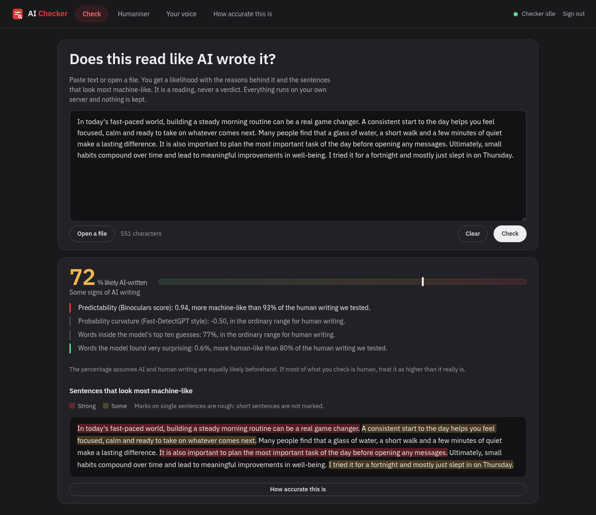

<div align="center">

# AI Checker and Humaniser

**Your own free take on an AI-writing detector. Paste text or open a file and get a likelihood with the reasons behind it and the sentences that look most machine-like, then rewrite text in a voice taken from your own writing. Everything runs on your own hardware.**

[](https://www.python.org/)
[](https://flask.palletsprojects.com/)
[](https://pytorch.org/)
[](LICENSE)

</div>



---

## Overview

AI Checker and Humaniser is a self-hosted web app in two parts. The **web app**
(Flask) has its own sign-in for one owner account, so a copy runs on its own.
The **scoring worker** loads a pair of small language models on a GPU only
while a check runs and unloads them shortly after. The two can run on one
machine or on two.

It gives a reading, never a verdict, and it makes no attempt to beat other
people's detectors. Text is held in memory for the length of one request or
job and is never written to disk. The only thing stored is the voice library:
passages from writing you add yourself.

- **Likelihood with reasons**: a percentage, a band (little sign, some signs,
  strong signs, too short to judge) and four plain-language reasons that each
  say how the text compares with human writing the checker was tested on.
- **Marked sentences**: the sentences that look most machine-like are
  highlighted, strong and some.
- **Open a file**: `.txt`, `.md`, `.docx`, `.odt` and `.pdf`, up to 8 MB each.
- **Humaniser**: rewrites a text in the voice of the writing you upload (or
  a folder you name), checks the result for changed numbers, names and
  quotes, and scores before and after.
- **An honest accuracy tab**: the measured numbers, including the groups
  where the checker is close to a coin toss, are shown in the app and in
  [Measured accuracy](#measured-accuracy) below.
- **Standalone sign-in** with a one-time setup code, or behind a sign-in
  proxy you already run.

---

## Requirements

- Python 3.11+ for the web app (`requirements-app.txt`: Flask, waitress, pypdf).
- For the scoring worker: an NVIDIA GPU with CUDA and about 9 GB of free video
  memory (the default `MIN_FREE_GPU_MB`), plus `requirements-worker.txt`
  (torch, transformers, safetensors).
- The two Qwen models the checker was calibrated with, downloaded once into
  `MODEL_DIR` (see [Models](#models)): `Qwen2.5-1.5B` and `Qwen2.5-1.5B-Instruct`.
- Only for the Humaniser and the Your voice tab: a model server that answers
  `GET /api/ps` and `POST /api/chat`, `/api/generate` and `/api/embed`, such
  as [ArtyEngine](https://github.com/drew-codes-things/ArtyEngine), with a
  chat model (default `qwen3:14b`) and an embedding model (default
  `nomic-embed-text`). Checking text does not need it.

---

## Install and run on your own machine

```bash
git clone <this repo> ai-checker
cd ai-checker
python3 -m venv .venv
.venv/bin/pip install -r requirements-app.txt
python3 -m venv .venv-worker
.venv-worker/bin/pip install -r requirements-worker.txt
cp .env.example .env
cp .worker.env.example .worker.env
```

Make one shared secret and put it in both files, as `WORKER_SECRET` in
`.env` and as `SECRET` in `.worker.env` (at least 32 bytes, and it is never
printed by the app):

```bash
python3 -c "import secrets; print(secrets.token_urlsafe(48))"
```

Start the worker, then the web app:

```bash
.venv-worker/bin/python -m aichecker.worker
.venv/bin/python -m aichecker.web
```

Then open `http://127.0.0.1:8113` and make the owner account (see below).
Your voice library and the account are stored in `./data`.

### Models

The worker reads the two models from folders named after them inside
`MODEL_DIR` (`./models` by default) and never reaches out to the network
(`HF_HUB_OFFLINE=1` in the example file). Download them once, for example:

```bash
.venv-worker/bin/python -c "
from huggingface_hub import snapshot_download
for name in ('Qwen2.5-1.5B', 'Qwen2.5-1.5B-Instruct'):
    snapshot_download(f'Qwen/{name}', local_dir=f'models/{name}')
"
```

The shipped calibration (`aichecker/data/calibration.json`) belongs to exactly
this pair. If you use other models, calibrate again (see
[Calibrating again](#calibrating-again)).

---

## First run and sign-in

The app has its own sign-in, switched on by default (`AUTH_MODE=builtin`).
There is one owner account and no sign-up page.

1. Start the web app and open `http://127.0.0.1:8113`. With no account yet
   every page goes to **Set up**.
2. The app writes a one-time setup code to its log when it starts, a line
   like `no owner account yet: open /setup and enter the setup code ...`.
   Enter that code, a user name and a password (10 characters or more,
   twice). The code stops anyone else who reaches the page first from making
   the account, and it works once: if the owner file is ever deleted, the
   next visit to **Set up** writes a new code to the log.
3. After that, every page goes to **Sign in** until you sign in. A session
   lasts 30 days. **Sign out** (top right) ends it on every device.

How it is protected:

- The password is stored as an scrypt hash in `DATA_DIR/owner.json`
  (mode 600), never in plain text.
- 5 wrong passwords or setup codes from one address within 15 minutes lock
  that address out for the rest of the 15 minutes (`429`). IPv6 addresses
  count by their `/64` network, and during an attack from many networks each
  address gets one try and each network three.
- A browser that has signed in before keeps a signed device cookie and has
  its own 5 tries, so a stranger who locks out your address cannot lock you
  out of that browser.
- The session cookie is `HttpOnly`, `SameSite=Lax` and signed with the app's
  secret key. It is `Secure` everywhere except plain `http` on `localhost`,
  `127.0.0.1` or `[::1]` (`SECURE_COOKIES=auto`). On a plain `http` address
  on your home network the browser drops a `Secure` cookie and the sign-in
  page says so: use https, or set `SECURE_COOKIES=false` there.
- Forget the password? Stop the app, delete `DATA_DIR/owner.json`, start it
  again and set up a new owner with the new setup code from the log. Your
  voice library stays.

By default the own sign-in answers only on `localhost`, `127.0.0.1`, `[::1]`,
IP addresses and this machine's own name; any other `Host` gets `421`, so a
web page cannot reach a copy on your machine by DNS rebinding. Behind a
reverse proxy for https, list the proxy's address in `TRUSTED_PROXIES` so the
lockout counts each visitor's address from `X-Forwarded-For`, and put the
public host name in `ALLOWED_HOSTS`.

`AUTH_MODE=local` switches the sign-in off for a copy only you use on this
machine: it then refuses to listen on anything but `127.0.0.1`, `::1` or
`localhost`.

To run it behind a sign-in proxy you already trust, set `AUTH_MODE=proxy` and
list the proxy's address in `TRUSTED_PROXIES`. This is opt-in: the user
header is believed only from those addresses, and in the default mode it is
never read.

---

## Configuration (`.env` or environment)

### Web app (`.env`)

| Key | Description |
|---|---|
| `AUTH_MODE` | `builtin` (default): the app's own sign-in, one owner account. `proxy`: trust the user header from a sign-in proxy listed in `TRUSTED_PROXIES`. `local`: no sign-in, loopback only. |
| `BIND_HOST` / `PORT` | Where the app listens. Default `127.0.0.1:8113`. |
| `DATA_DIR` | The voice library (`voice.db`), the owner account (`owner.json`) and the secret key (`secret_key`). Default `./data`. |
| `WORKER_URL` | Where the scoring worker listens, `http://127.0.0.1:8120` by default. Must start with `http://` or `https://`. |
| `WORKER_SECRET` or `WORKER_SECRET_FILE` | The shared secret, or a file holding it, at least 32 bytes. Must equal the worker's `SECRET`. Set one of them, not both. |
| `CALIBRATION_FILE` | The calibration the accuracy tab shows. Default: the one in the package. |
| `VOICE_FOLDER` | Optional folder whose files are added to the voice library when you press Rescan. Empty by default: nothing on the computer is read unless you upload it. |
| `MAX_CHECK_CHARACTERS` | Longest text accepted in one check. Default 60000. |
| `VOICE_MAX_CHUNKS_PER_FILE` | Passages kept from one voice file. Default 300. |
| `TRUSTED_PROXIES` | Addresses or networks whose user header is believed in `proxy` mode, comma separated. No default: `proxy` mode refuses to start without it. In `builtin` mode, the proxies whose `X-Forwarded-For` gives the visitor's address to the lockout. |
| `ALLOWED_HOSTS` | In `builtin` mode, the only host names the app answers on, comma separated (others get 421). Empty: `localhost`, `127.0.0.1`, `[::1]`, IP addresses and this machine's own name. |
| `SECURE_COOKIES` | `auto` (default), `true` or `false`. Only used in `builtin` mode. |
| `USER_HEADER` / `ALLOWED_USERS` | `proxy` mode: the header the proxy fills in (default `X-Forwarded-User`) and an optional list of the only users accepted. |
| `LOCAL_USER` | The user name shown in `local` mode. Default `local`. |
| `SECRET_KEY` | Optional. Without it a random key is made once in `DATA_DIR/secret_key` (mode 600). A key shorter than 32 bytes stops the app at start-up. |

### Scoring worker (`.worker.env`)

| Key | Description |
|---|---|
| `BIND_HOST` / `PORT` | Where the worker listens, `127.0.0.1:8120` by default. A wildcard address (`0.0.0.0`, `::`) is refused: name one address of this machine. |
| `ALLOWED_PEERS` | Addresses or networks the web app connects from, `127.0.0.1,::1` by default. Any other peer gets `403`. |
| `SECRET` or `SECRET_FILE` | The shared secret, or a file holding it, at least 32 bytes. Every request must send it in `X-Checker-Secret`. |
| `MODEL_DIR`, `OBSERVER_NAME`, `PERFORMER_NAME` | Where the models are and their folder names. Defaults `./models`, `Qwen2.5-1.5B`, `Qwen2.5-1.5B-Instruct`. |
| `CALIBRATION_FILE` | Default: the one in the package. |
| `IDLE_UNLOAD_SECONDS` | How long the pair stays loaded after the last check. Default 45. |
| `MIN_FREE_GPU_MB` | Free video memory needed before the pair is loaded. Default 9000. |
| `ENGINE_URL` | The model server used by the Humaniser, embeddings and for freeing video memory. Default `http://127.0.0.1:11438`. |
| `REWRITE_MODEL` / `EMBED_MODEL` | The chat and embedding models asked of the engine. Defaults `qwen3:14b` and `nomic-embed-text`. |
| `GPU_LOCK_FILE`, `QUIET_SECONDS`, `GATE_WAIT_SECONDS` | The GPU lock file (default `./gpu.lock`), and how long the engine must have been quiet and how long a check waits for the GPU. See [Sharing the GPU](#sharing-the-gpu). |
| `CONTROLLER_URL` | Optional controller for sharing the GPU with other jobs. Empty by default. |

---

## How the score works

One pass of text through two models, Qwen2.5-1.5B (observer) and
Qwen2.5-1.5B-Instruct (performer), gives token probabilities from which these
signals are taken:

- Binoculars: how surprising the text is to the performer, divided by how
  surprising the performer's guesses are to the observer. AI text sits low.
- Fast-DetectGPT (analytic form): how far the actual tokens sit above what the
  observer expects on average, in units of its spread.
- GLTR rank buckets: the share of words that were the observer's first choice,
  within its top ten, or far down its list.

A small logistic model combines the signals that were chosen on a validation
split of RAID. Thresholds for "some signs" and "strong signs" are set from
human texts in the training split (about 5 and 1 in 100 flagged). The
percentage shown assumes half of all texts are AI-written, so read it as a
strength of evidence and not as a probability about one person's text.
Sentence marks use per-sentence Binoculars thresholds taken from the same
human texts.

Texts under 48 tokens are not judged. Long texts are read in windows of 511
tokens, up to 4096 tokens.

## Measured accuracy

How it was measured: RAID `train_none.csv` (no adversarial attacks). From each of its 8 domains, 450 source texts were drawn at random with a fixed seed; each gives one human text and one AI text from a randomly chosen generator, cut to 4000 characters (7,192 texts). Texts were split by source into 60 percent train, 15 percent validation and 25 percent test (a hash of the source id, so a passage never lands on two sides). The combination weights, the choice of signals and the two thresholds were fitted on train and validation only. Everything below is the test split, which was not used for any fitting. Scoring ran on one RTX 3060, in groups of 96 texts.

What it says in plain words: the checker separates the two classes clearly better than chance (AUROC 0.85) but it is not strong. At the "strong signs" cut about 0.6 in 100 human texts were flagged and about half of the AI texts were caught. At the "some signs" cut about 5 in 100 human texts were flagged and about 60 in 100 AI texts were caught. It does badly on recipes, on texts from MPT and plain Cohere, and on text sampled with a repetition penalty (AUROC 0.46, no better than a coin toss). It does best on GPT-3, ChatGPT and Llama-chat output and on greedy decoding. The generators in RAID are from 2023 and early 2024; newer models were not measured. Do not use this as proof about a person.

Measured 2026-11-18 on held-out RAID documents (never used to fit anything).

Signals used: binoculars, fast_detect, gltr_top1, gltr_top10, gltr_tail. Chosen on a separate validation split; candidates scored {'binoculars': 0.8069, 'fast_detect': 0.8092, 'binoculars+fast_detect': 0.8041, 'binoculars+fast_detect+gltr_top1+gltr_top10+gltr_tail': 0.8397}.

Documents: train {'human': 2151, 'ai': 2154}, validation {'human': 509, 'ai': 509}, test {'human': 934, 'ai': 935}. Splits are by source text, so no passage appears on both sides.

#### Overall (test split)

| group | human | AI | AUROC | TPR at 1% FPR | TPR at 5% FPR | FPR at strong cut | TPR at strong cut | FPR at some cut | TPR at some cut |
|---|---|---|---|---|---|---|---|---|---|
| all | 934 | 935 | 0.853 | 50.5% | 60.3% | 0.6% | 48.6% | 5.0% | 60.4% |

### By domain

| group | human | AI | AUROC | TPR at 1% FPR | TPR at 5% FPR | FPR at strong cut | TPR at strong cut | FPR at some cut | TPR at some cut |
|---|---|---|---|---|---|---|---|---|---|
| abstracts | 109 | 109 | 0.803 | 60.6% | 67.0% | 0.0% | 56.9% | 4.6% | 67.0% |
| books | 123 | 123 | 0.931 | 76.4% | 78.9% | 0.0% | 41.5% | 0.0% | 54.5% |
| news | 113 | 113 | 0.911 | 69.9% | 76.1% | 0.0% | 54.0% | 0.9% | 66.4% |
| poetry | 110 | 110 | 0.885 | 43.6% | 65.5% | 0.0% | 30.0% | 0.9% | 40.9% |
| recipes | 140 | 140 | 0.723 | 37.1% | 52.1% | 3.6% | 48.6% | 19.3% | 59.3% |
| reddit | 110 | 109 | 0.909 | 56.0% | 66.1% | 0.9% | 55.0% | 5.5% | 67.0% |
| reviews | 112 | 114 | 0.900 | 58.8% | 74.6% | 0.0% | 48.2% | 1.8% | 58.8% |
| wiki | 117 | 117 | 0.886 | 59.0% | 70.1% | 0.0% | 54.7% | 4.3% | 70.1% |

### By text length (tokens)

| group | human | AI | AUROC | TPR at 1% FPR | TPR at 5% FPR | FPR at strong cut | TPR at strong cut | FPR at some cut | TPR at some cut |
|---|---|---|---|---|---|---|---|---|---|
| 0-128 | 14 | 85 | 0.908 | n/a | n/a | 0.0% | 63.5% | 0.0% | 74.1% |
| 128-256 | 260 | 272 | 0.859 | 53.3% | 63.2% | 0.4% | 48.9% | 4.2% | 59.9% |
| 256-400 | 406 | 259 | 0.864 | 53.7% | 62.2% | 0.7% | 51.7% | 6.2% | 65.2% |
| 400+ | 254 | 319 | 0.844 | 43.9% | 53.6% | 0.8% | 41.7% | 4.3% | 53.3% |

### By generator

| generator | AI | AUROC vs all human | TPR at strong cut | TPR at some cut |
|---|---|---|---|---|
| chatgpt | 97 | 0.950 | 49.5% | 73.2% |
| cohere | 89 | 0.782 | 28.1% | 38.2% |
| cohere-chat | 112 | 0.888 | 49.1% | 65.2% |
| gpt2 | 81 | 0.867 | 48.1% | 53.1% |
| gpt3 | 69 | 0.974 | 81.2% | 92.8% |
| gpt4 | 86 | 0.833 | 29.1% | 44.2% |
| llama-chat | 94 | 0.949 | 69.2% | 78.7% |
| mistral | 96 | 0.795 | 43.8% | 54.2% |
| mistral-chat | 66 | 0.899 | 59.1% | 71.2% |
| mpt | 70 | 0.680 | 31.4% | 37.1% |
| mpt-chat | 75 | 0.726 | 50.7% | 57.3% |

### By decoding

| generator | AI | AUROC vs all human | TPR at strong cut | TPR at some cut |
|---|---|---|---|---|
| greedy, repetition penalty no | 350 | 0.964 | 74.9% | 86.0% |
| greedy, repetition penalty yes | 125 | 0.851 | 52.8% | 64.8% |
| sampling, repetition penalty no | 363 | 0.851 | 32.2% | 47.4% |
| sampling, repetition penalty yes | 97 | 0.459 | 9.3% | 11.3% |

### Sentence marks

AUROC of a single sentence's predictability against its document's label: 0.689. Strong mark: 28.1% of AI sentences, 5.0% of human sentences. Some mark: 51.7% of AI sentences, 20.0% of human sentences.


### Calibrating again

`aichecker/data/calibration.json` was fitted from RAID alone, a public
benchmark of human and machine texts. It holds fitted weights, thresholds,
feature quantiles and the measured accuracy, and none of the texts. It was
not made from anyone's own writing. If you change the model pair, or want
numbers for your own kind of text, calibrate again:

```bash
.venv-worker/bin/python -m aichecker.worker.calibrate sample --csv train_none.csv --out sample.jsonl --per-domain 450
.venv-worker/bin/python -m aichecker.worker.calibrate run --sample sample.jsonl --out results.jsonl --model-dir models
.venv-worker/bin/python -m aichecker.worker.calibrate fit --results results.jsonl --out calibration.json --report report.md
```

then point `CALIBRATION_FILE` at the new file in both env files. `report
--calibration calibration.json` prints the accuracy tables as Markdown. The
`run` step names the default pair in `aichecker/worker/calibrate.py`, so other
models need that one place changed.

## Humaniser

Voice samples come only from files you upload on the Your voice tab, or from
a folder named by `VOICE_FOLDER` (empty by default). Nothing else on the
computer is read. Files are cut into passages and embedded with the embedding
model; the closest passages to the text being rewritten, plus a numeric
profile of your style (sentence length, contractions and so on), go into the
prompt for the chat model. The result is length-checked, meaning warnings
(numbers, names, quoted text that changed) are listed, and the checker scores
before and after. The prompt never mentions detectors. The Humaniser rewrites
in at most about 2,400 characters per part and keeps the original wording for
any part that comes back unusable twice. Read every rewrite against the
original: numbers, names and quotes are only flagged, not guaranteed.

---

## Sharing the GPU

Before loading anything the worker takes a lock file (`GPU_LOCK_FILE`), asks
the engine at `ENGINE_URL` which models it holds and unloads them if memory is
short, and gives everything back as soon as the engine is active again or
after `IDLE_UNLOAD_SECONDS`. If the engine is busy the app says so and asks you
to try again; a check that is running when the engine asks for the GPU is
stopped. With no engine running none of this does anything.

If you run other GPU jobs, `CONTROLLER_URL` can name a small controller that
the worker asks before it takes the GPU: `GET /status` answers
`{"arty_requests_in_flight": 0, "seconds_since_arty_was_used": 600.0}` (the
key names come from the author's own assistant), and the worker calls
`POST /busy` and `POST /done` with `{"id": "..."}` around its own use. It is
empty by default and optional.

---

## How sign-in and writes are protected

- In `builtin` mode (the default) a request is signed in only with the
  owner's session cookie; see [First run and sign-in](#first-run-and-sign-in).
  A user header is never read.
- In `proxy` mode a request is only signed in when it comes from an address
  in `TRUSTED_PROXIES` **and** carries a non-empty `USER_HEADER`. The same
  header sent from anywhere else is ignored and the request gets `401`. Every
  page and API call needs it except `/api/health`.
- Every write (`POST`, `PATCH`, `DELETE`) needs the `X-CSRF-Token` header from
  `/api/session`, an HMAC of the user made with the secret key. A write whose
  `Origin` is a different host is refused too. The sign-in forms are sent
  with `Referrer-Policy: same-origin` so the browser keeps the `Origin`
  header on them; everywhere else it is `no-referrer`.
- Pages ship a strict Content Security Policy (scripts, styles, fonts and
  images from the app itself only), `X-Frame-Options: DENY`, `nosniff` and
  `no-referrer`. API answers are `no-store`.
- The web app and the worker share a secret sent in `X-Checker-Secret`; the
  worker also refuses any peer outside `ALLOWED_PEERS` and a wildcard bind
  address. The worker has no sign-in of its own, so keep it on loopback or on
  a private network and never expose it.
- Uploads are cut at 8 MB, `.docx` and `.odt` are read with entity and
  doctype declarations refused, and requests are capped at 40 MB.
- Text sent for checking is held in memory for that one request and is never
  written to disk.

Anyone who can sign in can use the GPU and read the voice library. There is
one account and no sharing between users.

---

## Deploy

> **Written for the author's own setup.** `deploy.sh` installs the worker and
> the web app into two Proxmox containers behind a sign-in proxy. Read the
> scripts before running them; most people want the commands in
> [Install and run on your own machine](#install-and-run-on-your-own-machine)
> and a service manager of their choice.

`deploy.sh` runs from your own machine and reaches the containers through
`ssh` and `pct`. The values for your setup live in `deploy/site.env`, which
git ignores. Copy `deploy/site.env.example` and fill it in:

| Key | Description |
|---|---|
| `PROXMOX` | The ssh host name of the Proxmox machine. |
| `WORKER_CT` / `APP_CT` | The numbers of the container with the GPU and of the one that runs Caddy and the app. |
| `WORKER_HOST` / `APP_HOST` | Their LAN addresses. |
| `WORKER_PORT` / `APP_PORT` / `LAN_PORT` | The worker port, the app's loopback port and the https port Caddy serves on. |
| `SIGNED_IN_USER` | The proxy's admin account name; Caddy passes it on and it becomes `ALLOWED_USERS`. |
| `WORKER_DATA_ROOT` | An absolute path in the worker container holding `venv/` and `models/`, prepared by hand once. |
| `GPU_LOCK_FILE`, `CONTROLLER_URL` | Optional, as in the worker settings. |

On that setup the app runs with `AUTH_MODE=proxy` and
`TRUSTED_PROXIES=127.0.0.1,::1` (Caddy on the same machine); `deploy/app.env`
sets both. An env file left by an earlier install that has no `AUTH_MODE` line
gets `AUTH_MODE=proxy` added, so an upgrade never switches an install that
sits behind the proxy to the own sign-in.

```bash
./deploy.sh backup          # timestamped backups in both containers
./deploy.sh apply           # worker first, then the secret container to container, then the app, then both checks
./deploy.sh check           # read the "check failures:" lines, 0 is good
./deploy.sh undo            # app first, then the worker; the voice library, models and the secret are kept
```

---

## API

All paths need a signed-in session (in `proxy` mode, the signed-in user
header) except `/api/health` and the sign-in pages; writes also need
`X-CSRF-Token`.

| Method | Path | Purpose |
|---|---|---|
| GET | `/api/health` | `{"ok": true}` |
| GET | `/api/session` | Signed-in user, CSRF token, limits and whether there is a sign-out page |
| GET | `/api/status` | Whether the worker is reachable and the model pair loaded |
| GET | `/api/accuracy` | The measured accuracy and thresholds |
| POST | `/api/extract` | Read the text out of an uploaded file |
| POST | `/api/check` | `{"text": "..."}` gives the assessment, the signals and the marked sentences |
| GET | `/api/voice` | Voice library totals and sources |
| POST | `/api/voice/files` | Add files to the voice library |
| DELETE | `/api/voice/files/<id>` | Remove one |
| POST | `/api/voice/rescan` | Re-read `VOICE_FOLDER` |
| POST | `/api/humanise` | Start a rewrite job, answers `202` with a job id |
| GET / DELETE | `/api/jobs/<id>` | Follow or stop a rewrite |

The worker's own API (shared secret in `X-Checker-Secret`): `GET /v1/health`,
`GET /v1/calibration`, `POST /v1/score`, `POST /v1/embed`, `POST /v1/rewrite`.

---

## Limits

- It is a reading, not a verdict. Half of the AI texts in the held-out set were
  not marked strong, and the weakest groups (see the tables) are close to a
  coin toss.
- It was calibrated on English RAID texts cut to 4000 characters. Other
  languages, newer AI models and texts that were edited by a person were not
  measured.
- Texts under 48 tokens are not judged. Sentence marks are rougher than the
  whole-text reading.
- Do not use this as proof about a person.

---

## Tests

```bash
.venv/bin/pip install -r requirements-dev.txt -r requirements-app.txt
.venv/bin/python -m pytest -q
.venv/bin/pyflakes aichecker tests
```

`tests/test_signals.py` needs torch and is skipped without it; it runs in the
worker's virtual environment.

---

## Layout

- `aichecker/` pure Python: sentence splitting, metrics, calibration, report, fitting
- `aichecker/worker/` the scoring worker (torch lives only here), the GPU gate, the engine link, the calibration runner
- `aichecker/web/` the Flask app, its sign-in and its static page
- `aichecker/data/calibration.json` thresholds, quantiles and the measured accuracy
- `deploy.sh` and `deploy/` backup, apply, check and undo for two containers
- `tests/` the test suite

---

## Tech

- Flask served by waitress; the worker is a plain threaded HTTP server.
- Qwen2.5-1.5B and its instruct version through PyTorch and transformers,
  bfloat16.
- Plain HTML, CSS and JavaScript: no build step. The look and the colour
  tokens come from starfire, with the IBM Plex fonts bundled.

## License

MIT, see [LICENSE](LICENSE). The scoring signals follow Binoculars (BSD 3-Clause),
Fast-DetectGPT (MIT) and GLTR (Apache 2.0); their licences are in `licenses/`
and the credits are in [NOTICE](NOTICE). The Qwen models are Apache 2.0 and
are not part of this repository. The IBM Plex fonts are under the SIL Open Font
License (`aichecker/web/static/fonts/LICENSE-ibm-plex.txt`).
